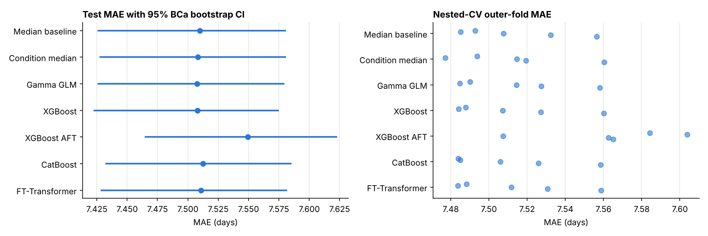
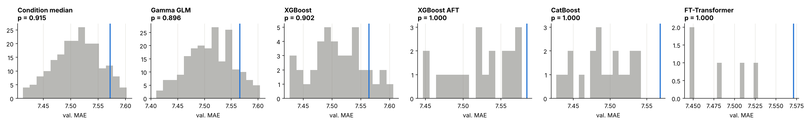

# RecoveryAI

**Length-of-stay estimation with validation first. An educational research prototype trained on synthetic data.**

> RecoveryAI is **not** a clinical tool. It is trained on the synthetic Kaggle dataset
> `prasad22/healthcare-dataset`, and nothing it outputs is a clinical discharge decision.

RecoveryAI does three things:

1. **Estimates hospital length of stay (LOS)** and the remaining stay, with split-conformal prediction intervals
   ("discharge may occur approximately within this range", never a date).
2. **Explains the available information** (test-result category, condition, medication) in plain language,
   without inventing lab values the dataset does not contain.
3. **Turns doctor-provided discharge orders into a daily recovery schedule**, structuring only what is written.
   Missing information stays *Not specified*.

## Research questions

* **Primary.** To what extent can patient characteristics available near hospital admission predict length of stay in a
  synthetic healthcare dataset, and how reliably can modern machine-learning models quantify uncertainty in those predictions?
* **Secondary.** Do advanced nonlinear machine-learning models provide statistically meaningful predictive improvement
  over simple statistical and naive baselines?

## Results (full run, committed in `validation/results/`)

**Answer to both research questions: no.** In this synthetic dataset, admission-time characteristics carry no detectable
information about length of stay. Advanced models do not improve on predicting the median for everyone. The validation
framework is not the reason: given a known injected effect, it detects it easily (see the positive control).

| Model | Nested-CV MAE (mean ± SD) | Test MAE | 95% BCa CI | Test R² | Δ MAE vs median (95% CI) |
|---|---:|---:|---:|---:|---:|
| Median baseline | 7.515 ± 0.029 | 7.510 | 7.43–7.58 | −0.003 | — |
| Condition median | 7.513 ± 0.031 | 7.508 | 7.43–7.58 | −0.003 | −0.013 to 0.009 |
| Gamma GLM | 7.515 ± 0.030 | 7.508 | 7.43–7.58 | 0.000 | −0.012 to 0.008 |
| XGBoost | 7.513 ± 0.031 | 7.508 | 7.42–7.57 | −0.001 | −0.016 to 0.011 |
| XGBoost AFT | 7.565 ± 0.036 | 7.549 | 7.47–7.62 | −0.018 | **+0.027 to +0.053** (worse) |
| CatBoost | 7.512 ± 0.031 | 7.512 | 7.43–7.59 | −0.001 | −0.009 to 0.014 |
| FT-Transformer | 7.515 ± 0.031 | 7.511 | 7.43–7.58 | −0.001 | −0.006 to 0.008 |

* **Selection.** CatBoost has the lowest point estimate (7.512), but all 7 models are statistically indistinguishable
  (corrected resampled t-test). Parsimony therefore selects the **median baseline**, decided before the test set was opened.
* **Shuffled-target control.** Real-target models do *not* beat shuffled-target models. Empirical permutation p-values are
  0.90 (GLM, 200 shuffles), 0.90 (XGBoost, 40), 1.00 (CatBoost, 20), 1.00 (FT-Transformer, 5).
  > The synthetic dataset does not appear to contain strong predictive relationships for hospital length of stay.
* **Gamma GLM.** Likelihood-ratio test vs intercept-only: χ²(23) = 26.1, p = 0.29. ΔAIC = +19.9 and ΔBIC = +216 favour the
  null model. Every exp(β) lies within 0.99–1.02 and every 95% CI includes 1. AIC = 273,478.5, AICc = 273,478.5, BIC = 273,691.7.
* **Survival view.** C-index 0.503 (AFT) and 0.506 (GLM), essentially chance. The integrated Brier score (0.180 / 0.181)
  is no better than Kaplan–Meier with no features (0.177).
* **Conformal intervals.** Coverage is honest (90% nominal → 89.9% empirical), but intervals are 27.0 days wide, identical
  to a no-information interval (ratio 1.00).
* **Learning curves.** Training and validation errors converge at about 7.54 with a small gap. More data would not help.
* **Feature set B** (adds Billing Amount and other research variables) gives no gain either (CatBoost B − A: corrected
  p = 0.92). Even the leakage-prone final bill carries no LOS signal in this synthetic data.
* **Positive control.** On a semi-synthetic target with a known admission-type, condition and age effect, the same
  pipeline reaches R² ≈ 0.25 and MAE 4.68 vs 5.39 for the median, with the permutation p at its floor (1/11).
* **Quality gate.** All five checks fail, so every prediction in the app carries the methodology warning.

LOS in the source data is close to uniform on 1–30 days (mean 15.5, SD 8.7), with near-identical means in every subgroup.
That is consistent with the target having been generated independently of the other columns.





## Repository layout

```
data/          raw CSV (synthetic) + split manifest / holdout indices
training/      data prep, model wrappers, pipeline orchestration
  statistical_baseline.py   Gamma GLM (AIC/AICc/BIC, LR test, LOOCV demo)
  train_catboost.py / train_xgboost.py (log-target + AFT survival) / train_ft_transformer.py
  baselines.py, run_pipeline.py, config.py (seeds + compute budgets)
validation/    nested_cv.py, repeated_cv.py, tuning.py (Optuna), bootstrap_validation.py,
               permutation_tests.py, conformal_prediction.py, calibration.py, learning_curves.py,
               error_analysis.py, survival_metrics.py, explainability.py, model_comparison.py,
               positive_control.py, plots.py
               results/  validation_report.json, selection.json, optuna/ trials, cache/, positive_control.json
               figures/  static PNGs
models/        exported artefacts (JSON GLM, CatBoost .cbm, XGBoost .json, FT-Transformer .pt + .npz) + manifest.json
backend/       FastAPI inference API (no torch/sklearn/shap at runtime) + recovery planner
frontend/      Next.js 16 + TypeScript + Tailwind 4 + shadcn/ui-style components (Manrope / Sora)
notebooks/     research walkthrough notebook (generated from the report)
tests/         leakage, splits, statistics, models, FT NumPy/PyTorch parity, recovery planner, API
render.yaml    Render Blueprint (API + web)
```

## Methodology

| Step | What was done | Why |
|---|---|---|
| Target | `Length_of_Stay = Discharge Date − Date of Admission` | Defined by the brief |
| Cleaning | 534 exact duplicate records removed (names normalised for case) | Duplicates on both sides of a split leak test rows into training |
| Leakage control | Set A uses only age, gender, blood type, condition, admission type, medication and test result. Discharge date, anything derived from it, the final bill and the name are excluded | The admission-time model must not see post-discharge information |
| Identifiers | Doctor (~40k unique) and Hospital (~40k unique) excluded from set A; set B tests fold-fitted frequency encodings | Near-unique synthetic names behave like IDs |
| Feature set B | + insurance, room, admission calendar, Doctor/Hospital frequency, **Billing Amount (leakage-risk)** | Research-only experiment, never served |
| Holdout | 20% stratified by LOS decile, fingerprinted (SHA-256) and used **once** | Unbiased final estimate |
| Calibration split | 15% of development data reserved for split conformal | Valid finite-sample coverage |
| Nested CV | Outer 5-fold; inner 5-fold (3 for the transformer) running Optuna + feature-subset + preprocessing choices | Separates tuning from evaluation |
| Repeated CV | 3 × 5-fold, identical folds for every model | Stability (mean, SD, median, IQR) and paired tests |
| Bootstrap | 1,000 resamples of test predictions, percentile + BCa (grouped jackknife) CIs; paired bootstrap differences | Uncertainty in metrics and comparisons |
| Negative control | Shuffled-target refits, empirical p = (#shuffled ≤ observed + 1)/(n + 1) | Is there any signal at all? |
| Positive control | Same pipeline on a semi-synthetic target with a known effect | Would we have detected signal if it existed? |
| Selection | Rank by nested-CV MAE; Nadeau–Bengio corrected resampled t-test vs leader; simplest model in the equivalence set wins; locked before the test | The smallest point estimate does not automatically win |
| Intervals | Split conformal (50/80/90/95%), coverage overall and by subgroup, compared with a no-information interval | Honest per-patient uncertainty |
| Explainability | TreeSHAP (CatBoost, XGBoost), GLM coefficients, permutation importance (incl. FT-Transformer) | Associational, never causal; attention is not used |
| Quality gate | 5 automatic checks drive a warning on every prediction | Results are not presented as more than they are |

**Information criteria.** AIC, AICc and BIC are reported only for the likelihood-based Gamma GLM and its specifications
(same response, same data). They are not computed for boosted trees or neural networks: those models have no comparable
likelihood or parameter count, so an "AIC" for them would be meaningless.

**LOOCV.** Full LOOCV would need about 44,000 refits per model and per hyper-parameter setting, and adds little over
repeated K-fold CV, since its estimate has high variance and near-identical folds. It is demonstrated only for the GLM on a
1,000-row subsample.

**Remaining stay.** `max(0, predicted total LOS − days already in hospital)`, with the interval shifted and clamped the
same way. A survival-adjusted estimate from the Gamma GLM, the distribution of T − d given T > d, is shown alongside it,
because the naive subtraction ignores that the patient is still in hospital.

## Running locally

```bash
pip install -r training/requirements.txt
```

```bash
python -m training.run_pipeline --budget full   # ~25-60 min on 4 CPU cores; --budget quick for a smoke test
```

```bash
python -m validation.positive_control && python -m validation.plots && python notebooks/build_notebook.py --execute
```

```bash
uvicorn backend.app.main:app --reload --port 8000
```

```bash
cd frontend && npm install && BACKEND_URL=http://localhost:8000 npm run dev
```

```bash
pytest -q tests
```

Set `ANTHROPIC_API_KEY` to let Claude structure discharge text. Without it, a deterministic rule-based extractor is used.
Either way, every extracted item passes a **grounding check**. It must quote the source verbatim, and any dose, frequency,
duration or date not present in that quote is replaced with *Not specified*.

## Deploying on Render

`render.yaml` defines two web services:

* `recoveryai-api`: Python, `uvicorn backend.app.main:app`, serving the committed `models/`.
* `recoveryai-web`: Node, Next.js, proxying `/api/*` to the API via `BACKEND_URL` (taken from the API service's host).

Render reads the Blueprint from the branch you select, and it must contain `render.yaml` at the repository root.
Merge this branch into `main`, or point the Blueprint at this branch. Optionally add `ANTHROPIC_API_KEY` to the API service.

## Reproducibility

Global seed `20240531` (see `training/config.py`) seeds Python, NumPy, PyTorch, CatBoost, XGBoost, Optuna samplers and
every CV split. The report stores seeds, library versions, the compute budget, every Optuna trial (`validation/results/optuna/`),
CV folds, bootstrap results and the test-set fingerprint. Stage outputs are cached in `validation/results/cache/full/`.

## Limitations

* The data are **synthetic**. Variables appear to be generated independently, so real-world relationships need not exist.
* Test results are categories only. The dataset gives no test names, values or reference ranges.
* Condition, medication and test-result combinations may not make clinical sense.
* Subgroup error differences describe model behaviour, not biology.
* Nothing here generalises to real patients.
